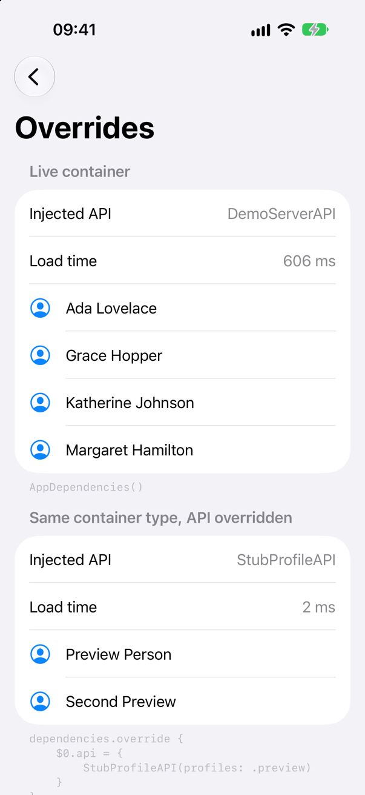
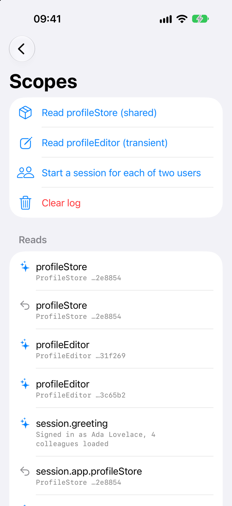
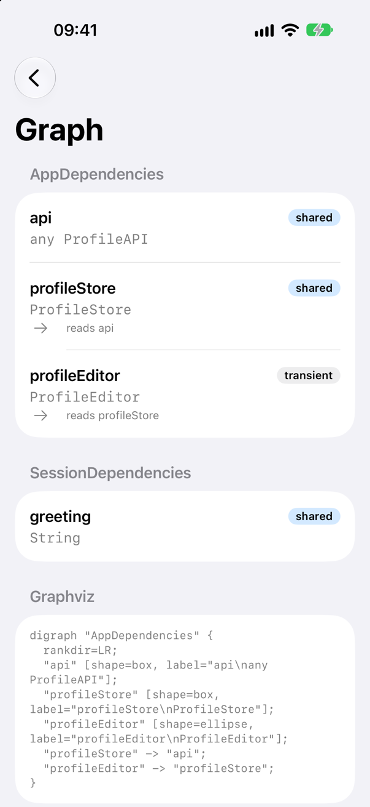

<!-- brand:start -->

<p align="center"><picture><source media="(prefers-color-scheme: dark)" srcset="https://raw.githubusercontent.com/muhittincamdali/SwiftDependencyInjection/main/.github/brand/banner-dark.svg"><source media="(prefers-color-scheme: light)" srcset="https://raw.githubusercontent.com/muhittincamdali/SwiftDependencyInjection/main/.github/brand/banner-light.svg"></picture></p>

<!-- lang-selector:start -->
<p align="center"><a href="README.md">English</a> · <a href="README.tr.md">Türkçe</a> · <a href="README.zh-CN.md">简体中文</a> · <a href="README.ja.md">日本語</a> · <a href="README.ko.md">한국어</a> · <a href="README.es.md">Español</a> · <a href="README.de.md">Deutsch</a> · <a href="README.fr.md">Français</a> · <a href="README.pt-BR.md">Português (Brasil)</a> · <a href="README.ru.md">Русский</a></p>
<!-- lang-selector:end -->

<p align="center">
<a href="https://github.com/muhittincamdali/SwiftDependencyInjection/actions/workflows/ci.yml"></a>
<a href="https://github.com/muhittincamdali/SwiftDependencyInjection/releases"><picture><source media="(prefers-color-scheme: dark)" srcset="https://raw.githubusercontent.com/muhittincamdali/SwiftDependencyInjection/main/.github/brand/badge-version-dark.svg"><source media="(prefers-color-scheme: light)" srcset="https://raw.githubusercontent.com/muhittincamdali/SwiftDependencyInjection/main/.github/brand/badge-version-light.svg"></picture></a>
<a href="https://github.com/muhittincamdali/SwiftDependencyInjection/blob/main/Package.swift"><picture><source media="(prefers-color-scheme: dark)" srcset="https://raw.githubusercontent.com/muhittincamdali/SwiftDependencyInjection/main/.github/brand/badge-platforms-dark.svg"><source media="(prefers-color-scheme: light)" srcset="https://raw.githubusercontent.com/muhittincamdali/SwiftDependencyInjection/main/.github/brand/badge-platforms-light.svg"></picture></a>
<a href="https://github.com/muhittincamdali/SwiftDependencyInjection/blob/main/Package.swift"><picture><source media="(prefers-color-scheme: dark)" srcset="https://raw.githubusercontent.com/muhittincamdali/SwiftDependencyInjection/main/.github/brand/badge-language-dark.svg"><source media="(prefers-color-scheme: light)" srcset="https://raw.githubusercontent.com/muhittincamdali/SwiftDependencyInjection/main/.github/brand/badge-language-light.svg"></picture></a>
<a href="https://github.com/muhittincamdali/SwiftDependencyInjection/blob/main/LICENSE"><picture><source media="(prefers-color-scheme: dark)" srcset="https://raw.githubusercontent.com/muhittincamdali/SwiftDependencyInjection/main/.github/brand/badge-license-dark.svg"><source media="(prefers-color-scheme: light)" srcset="https://raw.githubusercontent.com/muhittincamdali/SwiftDependencyInjection/main/.github/brand/badge-license-light.svg"></picture></a>
</p>

<p align="center">
<a href="#quick-start"><picture><source media="(prefers-color-scheme: dark)" srcset="https://raw.githubusercontent.com/muhittincamdali/SwiftDependencyInjection/main/.github/brand/button-start-en-dark.svg"><source media="(prefers-color-scheme: light)" srcset="https://raw.githubusercontent.com/muhittincamdali/SwiftDependencyInjection/main/.github/brand/button-start-en-light.svg"></picture></a>
<a href="https://muhittincamdali.github.io/SwiftDependencyInjection/documentation/swiftdependencyinjection/"><picture><source media="(prefers-color-scheme: dark)" srcset="https://raw.githubusercontent.com/muhittincamdali/SwiftDependencyInjection/main/.github/brand/button-docs-en-dark.svg"><source media="(prefers-color-scheme: light)" srcset="https://raw.githubusercontent.com/muhittincamdali/SwiftDependencyInjection/main/.github/brand/button-docs-en-light.svg"></picture></a>
<a href="https://github.com/muhittincamdali/SwiftDependencyInjection/tree/main/Examples"><picture><source media="(prefers-color-scheme: dark)" srcset="https://raw.githubusercontent.com/muhittincamdali/SwiftDependencyInjection/main/.github/brand/button-examples-en-dark.svg"><source media="(prefers-color-scheme: light)" srcset="https://raw.githubusercontent.com/muhittincamdali/SwiftDependencyInjection/main/.github/brand/button-examples-en-light.svg"></picture></a>
</p>

<!-- brand:end -->

SwiftDependencyInjection is manual dependency injection for Swift 6 with the repetitive parts
generated. You list your dependencies as computed properties of one final class; the
`@DependencyContainer` macro makes it a container: each `shared` dependency is built once and
cached thread-safely, each `transient` one is built on every read, tests replace any of them
through a generated, typed `override`, and a dependency cycle is a compile error. There is no
global container and no lookup that can fail at run time: a dependency is a property, so a
missing one does not compile.

## Highlights

- **Checked by the compiler** — a dependency is a property, so a missing one or a wrong type is a
  compile error. The macro reports cycles (`api → tokens → api`), providers in the wrong place
  and dependencies an override could not replace, each with the fix in the message.
- **Typed test overrides** — every container gets an `Overrides` struct with one field per
  dependency, typed like the property: `$0.api = { StubProfileAPI(…) }`.
- **No global state** — instances and overrides belong to one container instance. Tests that each
  create a container can run in parallel; a child container is a scope, such as a signed-in user.
- **Swift 6 concurrency** — a shared dependency is built exactly once when many threads read it.
  `@MainActor` containers get `@MainActor` overrides, other containers `@Sendable` ones.
- **Cycles caught at run time too** — a cycle the macro cannot see, through a method or a
  closure, stops the process with the same path instead of overflowing the stack.
- **A graph you can read** — each container has a `dependencyGraph`, written at compile time,
  with Graphviz output.

## Quick start

**1. Add the package**

In Xcode, choose **File › Add Package Dependencies…** and enter the repository URL:

```text
https://github.com/muhittincamdali/SwiftDependencyInjection.git
```

**2. Import the module**

```swift
import SwiftDependencyInjection
```

**3. Declare a container**

Each dependency is a computed property whose getter is one `shared` or `transient` call with the
key path of that property
([ReadmeSamples.swift](Examples/DependencyDemo/DependencyDemo/ReadmeSamples.swift)):

```swift
@MainActor
@DependencyContainer
final class AppDependencies {
    let configuration: AppConfiguration

    init(configuration: AppConfiguration = .production) {
        self.configuration = configuration
    }

    var api: any ProfileAPI {
        shared(\.api) { DemoServerAPI(latency: configuration.latency) }
    }

    var profileStore: ProfileStore {
        shared(\.profileStore) { ProfileStore(api: api) }
    }

    var profileEditor: ProfileEditor {
        transient(\.profileEditor) { ProfileEditor(store: profileStore) }
    }
}
```

Create it once and read what you need: `AppDependencies().profileStore` builds the API and the
store on first use and returns the same store afterwards. The key path gives each instance the
type of its property, so `api` is stored as `any ProfileAPI` and a test can replace it with any
other conforming type.

## Installation

### Swift Package Manager

In Xcode, choose **File › Add Package Dependencies…** and enter the repository URL:

```text
https://github.com/muhittincamdali/SwiftDependencyInjection.git
```

Or add it to the `dependencies` in your `Package.swift`:

```swift
dependencies: [
    .package(url: "https://github.com/muhittincamdali/SwiftDependencyInjection.git", branch: "main")
],
targets: [
    .target(name: "YourApp", dependencies: [
        .product(name: "SwiftDependencyInjection", package: "SwiftDependencyInjection")
    ])
]
```

The package contains a Swift macro, so Xcode asks once to trust it (**Trust & Enable**) and the
build uses [swift-syntax](https://github.com/swiftlang/swift-syntax) (602 to 604).

## Usage

The samples below are copied from
[`ReadmeSamples.swift`](Examples/DependencyDemo/DependencyDemo/ReadmeSamples.swift) and
[`DependencyDemoApp.swift`](Examples/DependencyDemo/DependencyDemo/DependencyDemoApp.swift), which
the example app builds, and from
[`ReadmeSamplesTests.swift`](Tests/SwiftDependencyInjectionTests/ReadmeSamplesTests.swift), which
the test suite runs.

### Create the container once

The app owns its container and passes it, or the dependencies it needs, down:

```swift
@main
struct DependencyDemoApp: App {
    /// The app-wide container: created once, when the scene starts, and passed down.
    @State private var dependencies = AppDependencies()

    var body: some Scene {
        WindowGroup {
            ContentView(dependencies: dependencies, initialDemo: Demo.fromLaunchArguments())
                .tint(Color(red: 0.04, green: 0.52, blue: 1.0))
        }
    }
}
```

Objects get their dependencies through their initializers (`ProfileStore(api:)`), so each one can
also be built on its own in a test, without a container.

### Replace dependencies in a test

`override(_:)` takes a closure that sets fields of the generated `Overrides`; fields left `nil`
keep the real dependency. The real `profileStore` provider runs and reads the stub:

```swift
let dependencies = AppDependencies()
dependencies.override {
    $0.api = { StubProfileAPI(profiles: [Profile(id: 1, name: "Ada", role: "Analyst")]) }
}

let store = dependencies.profileStore
try await store.refresh()

#expect(store.profiles.map(\.name) == ["Ada"])
```

Each test creates its own container, so overrides never leak between tests and Swift Testing can
run them in parallel. Previews use the same call.

### Scope dependencies to a session

A container instance is a scope. A child container holds its parent and the values of the scope
as stored properties, so nothing inside it has to handle a missing user:

```swift
@MainActor
@DependencyContainer
final class SessionDependencies {
    let app: AppDependencies
    let user: Profile

    init(app: AppDependencies, user: Profile) {
        self.app = app
        self.user = user
    }

    var greeting: String {
        shared(\.greeting) { "Signed in as \(user.name), \(app.profileStore.profiles.count) colleagues loaded" }
    }
}
```

Create one when a user signs in and release it when they sign out; its shared instances go with
it, while `app.profileStore` stays shared by every session.

### Let the compiler find cycles

A provider that needs itself, directly or through other dependencies, does not compile:

```swift
var api: any ProfileAPI {
    shared(\.api) { TokenRefreshingAPI(tokens: tokens) }
}

var tokens: TokenStore {
    shared(\.tokens) { TokenStore(api: api) }
}
```

```text
error: Dependency cycle: api → tokens → api. 'api' needs itself while it is being built; pass one
side a closure that reads the other later, or move the shared part into its own dependency
```

Reads inside nested closures are not followed, because a callback usually runs after building.
If such a closure runs while building, the container stops the process with
`dependency cycle in AppDependencies: api → tokens → api` instead of overflowing the stack.

## Demo

The [DependencyDemo](Examples/DependencyDemo) app runs each idea with the real library. The
screenshots come from the app on an iOS 27 simulator, captured by
[`scripts/capture-example-screens.sh`](scripts/capture-example-screens.sh):

| Live and overridden API | Shared, transient and sessions | Generated graph |
| --- | --- | --- |
| <picture><source media="(prefers-color-scheme: dark)" srcset="docs/images/demo-overrides-dark.png"></picture> | <picture><source media="(prefers-color-scheme: dark)" srcset="docs/images/demo-scopes-dark.png"></picture> | <picture><source media="(prefers-color-scheme: dark)" srcset="docs/images/demo-graph-dark.png"></picture> |

To run it, open `DependencyDemo.xcodeproj` in [Examples/DependencyDemo](Examples/DependencyDemo)
with Xcode 26 or later, choose an iPhone simulator or **My Mac**, and press **Run**.
[Examples/README.md](Examples/README.md) describes each screen.

## When to choose Factory or swift-dependencies instead

[Factory](https://github.com/hmlongco/Factory) and
[swift-dependencies](https://github.com/pointfreeco/swift-dependencies) are the most widely used
Swift dependency injection libraries, and they do things this package does not:

- **Choose Factory** to inject anywhere with `@Injected` without passing a container, for
  parameterized factories, more scopes (cached, weak shared, graph, custom), decorators, and
  contexts that switch implementations for previews, tests and debug builds automatically.
- **Choose swift-dependencies** with The Composable Architecture, when dependencies such as the
  clock, the date and UUIDs should reach any code through task locals, or when an unexpected use
  of a dependency in a test should fail it.
- **Choose [SafeDI](https://github.com/dfed/SafeDI)** to validate a whole object graph across
  modules at compile time with generated initializers and mocks.
- **Choose this package** for explicit constructor injection with one container class per scope,
  typed overrides, and cycles reported by the compiler.

The article
[Choosing a dependency injection library](https://muhittincamdali.github.io/SwiftDependencyInjection/documentation/swiftdependencyinjection/choosingadependencyinjectionlibrary)
compares them feature by feature and lists the limits of this package.

## Documentation

Reference documentation and articles:

- [SwiftDependencyInjection reference](https://muhittincamdali.github.io/SwiftDependencyInjection/documentation/swiftdependencyinjection/)
- [Getting started](https://muhittincamdali.github.io/SwiftDependencyInjection/documentation/swiftdependencyinjection/gettingstarted)
- [Testing with overrides](https://muhittincamdali.github.io/SwiftDependencyInjection/documentation/swiftdependencyinjection/testingwithoverrides)
- [Scopes and lifetimes](https://muhittincamdali.github.io/SwiftDependencyInjection/documentation/swiftdependencyinjection/scopesandlifetimes)
- [Choosing a dependency injection library](https://muhittincamdali.github.io/SwiftDependencyInjection/documentation/swiftdependencyinjection/choosingadependencyinjectionlibrary)

## Guides

- [Getting started](Sources/SwiftDependencyInjection/SwiftDependencyInjection.docc/GettingStarted.md)
  — declaring a container, choosing its isolation, passing dependencies on, and what the compiler
  checks.
- [Testing with overrides](Sources/SwiftDependencyInjection/SwiftDependencyInjection.docc/TestingWithOverrides.md)
  — how overrides are typed, scoped, cached and isolated, and how to use them in previews.
- [Scopes and lifetimes](Sources/SwiftDependencyInjection/SwiftDependencyInjection.docc/ScopesAndLifetimes.md)
  — shared and transient, child containers, cycles and the dependency graph.
- [Choosing a dependency injection library](Sources/SwiftDependencyInjection/SwiftDependencyInjection.docc/ChoosingADependencyInjectionLibrary.md)
  — Factory, swift-dependencies, SafeDI and this package side by side.

## Requirements

| Platform | Minimum version |
| --- | --- |
| iOS | 16 |
| macOS | 13 |
| tvOS | 16 |
| watchOS | 9 |
| visionOS | 1 |
| Toolchain | Swift 6.2 · Xcode 26+ |

## Architecture

The package has one library and one macro target:

| Target | Contents |
| --- | --- |
| `SwiftDependencyInjection` | `DependencyContainer` (the protocol with `shared` and `transient`), `DependencyStorage`, `DependencyGraph`, the `@DependencyContainer` declaration |
| `SwiftDependencyInjectionMacros` | The macro: reads the class body, generates the members, finds cycles and reports misuse |

Design decisions:

- **Properties, not registrations.** A dependency is a computed property, so the compiler checks
  every use. Nothing is registered at launch, so nothing can be missing at run time.
- **The key path is the key.** `shared(\.api)` stores the instance under the key path of its
  property, which also fixes its type to the property's type, so overrides of another
  conforming type fit and two properties can never share an entry.
- **One recursive lock per container.** It is held while a provider runs: a shared dependency is
  built exactly once, providers can read each other, and the chain being built doubles as the
  run-time cycle check.
- **Overrides are generated, not stored by name.** The macro writes a typed field per dependency
  and gives the closures the container's isolation.
- **The container is the scope.** No global state means no reset between tests and no hidden
  lifetime: a container's instances live exactly as long as it does.

## Roadmap

- Parameterized dependencies (`func editor(for: Profile)`) that can be overridden like
  properties.
- An optional weak lifetime: one instance while something holds it, rebuilt afterwards.
- A trace of what was built during a resolution, for debugging large containers.

## Contributing

Contributions are welcome. Read the [contributing guide](https://github.com/muhittincamdali/SwiftDependencyInjection/blob/main/CONTRIBUTING.md) and the [code of conduct](https://github.com/muhittincamdali/SwiftDependencyInjection/blob/main/CODE_OF_CONDUCT.md) before opening a pull request. Report security issues privately as described in the [security policy](https://github.com/muhittincamdali/SwiftDependencyInjection/blob/main/SECURITY.md).

## License

Released under the MIT license. See [LICENSE](LICENSE).
